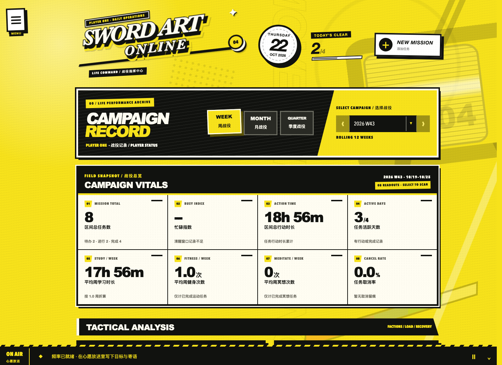
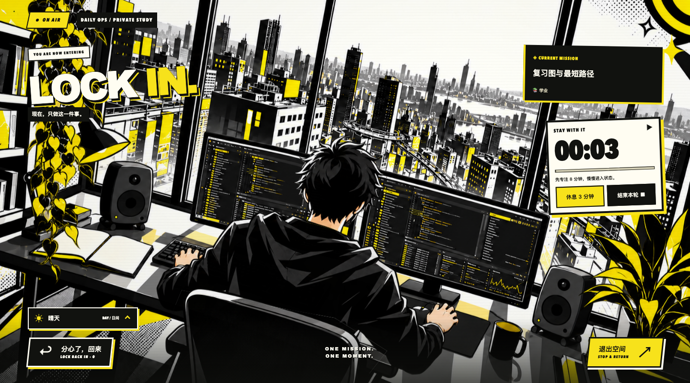
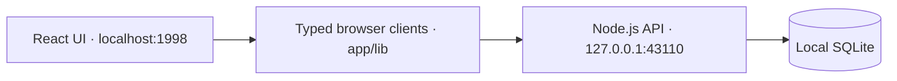

# Sword Art Online — Daily Operations

A local-first life dashboard for planning missions, tracking progress, and finding focus. Built with React and TypeScript, with a retro JRPG interface and a local SQLite database.

[](https://github.com/2DimensionalM/sword-art-online-daily-operations/actions/workflows/ci.yml)
[](LICENSE)
[](.nvmrc)


**[Features](#features) · [Run locally](#run-locally) · [Architecture](#architecture) · [Development](#development) · [中文介绍](docs/README.zh-CN.md)**

## Features

| Area | What it does |
| --- | --- |
| **Daily Ops** | Three-column mission board with drag-and-drop transitions, custom ordering, priorities, deadlines, and recurring tasks |
| **Life Command** | Progress dashboard with calendar drilldowns, task categories, and daily activity |
| **Mission archive & calendar** | Search and filter tasks, inspect completed missions, and plan a daily agenda |
| **Lockin Channel** | Task-linked focus sessions, manual breaks, distraction logging, and searchable history in an animated study space |
| **Signal Room** | Dated goals, personal messages, and a trophy gallery for completed goals |
| **Night Log** | Sleep windows grouped by their local wake date |
| **Personalization** | Day/night themes, custom task types and locations, and configurable defaults |

The interface uses Chinese copy alongside English tactical labels. The study scene supports reduced motion and manually selected simulated weather; it does not request location access.

<details>
<summary>Preview: Life Command</summary>



</details>

<details>
<summary>Preview: Lockin Channel</summary>



</details>

Preview images use fictional data in an isolated temporary database. See [preview notes](docs/images/README.md).

## Run locally

Requires **Node.js 22.13+** and npm. The pinned development version is in [.nvmrc](.nvmrc).

```sh
git clone https://github.com/2DimensionalM/sword-art-online-daily-operations.git
cd sword-art-online-daily-operations
npm ci
npm run dev
```

Open **[localhost:1998](http://localhost:1998)**. The launcher starts the web application and SQLite API together; `Ctrl+C` stops both. No account, API key, or external database is required. SQLite is created automatically on first launch.

For a production build served locally:

```sh
npm run build
npm run start
```

This application is intended for use on one trusted computer. Its unauthenticated loopback API is not suitable for public hosting or network exposure. Cloudflare tooling supplies the local Vinext runtime; data stays in the local SQLite file.

## Architecture



- **Frontend:** React 19, TypeScript in strict mode, and the Next.js App Router API through Vinext/Vite. No Next.js server process is used.
- **Persistence:** Node's built-in SQLite module. Planner writes use transactions and revision checks to reject stale updates from another tab. Focus and signals have independent revisions.
- **Focus lifecycle:** Server timestamps, idempotent commands, and scoped ownership tokens preserve session history across retries and reconnects.
- **Visual system:** Shared design tokens and an isolated perspective wordmark, with a source-level design harness. SVG, CSS, and canvas compose the study scene without a WebGL engine.

SQLite is the source of truth across browser sessions and frontend origins. Browser `localStorage` is used only for a guarded, one-time legacy import; `sessionStorage` holds transient UI preferences. There is no cloud synchronization or multi-user authentication.

Read the [architecture overview](docs/ARCHITECTURE.md), [data contract](docs/DATA_ARCHITECTURE.md), and [style guide](docs/STYLE_GUIDE.md) for implementation details and tradeoffs. Vinext is a beta dependency; this project does not claim complete Next.js compatibility.

## Development

| Command | Purpose |
| --- | --- |
| `npm run dev` | Start the complete local stack with hot reload |
| `npm test` | Run model and isolated SQLite API tests |
| `npm run lint` | Run the design harness and ESLint |
| `npm run typecheck` | Check TypeScript without emitting files |
| `npm run build` | Build to `dist/` |
| `npm run check` | Run lint, typecheck, tests, and production build |
| `npm run db:backup` | Create a consistent SQLite copy in ignored `backups/` |
| `npm run recover:legacy -- --port 3001` | Recover legacy storage from an old local origin |

CI runs the same quality gate on Node.js 22.13 and 24. Tests use temporary databases and OS-assigned loopback ports, without touching personal data. They cover Pending-divider ordering, focus timing and lifecycle, signal validation and persistence, migrations, and scene day/night boundaries. They do not replace manual browser checks.

See [CONTRIBUTING.md](CONTRIBUTING.md) for the workflow and [local troubleshooting](docs/DEVELOPMENT.md) for startup and data recovery.

## Data & backups

Personal data lives in `data/sword-art-online.sqlite`. Live databases, backups, recovery exports, environment files, and private moodboard PNGs are excluded from Git. A checkout includes application code and product artwork, not the owner's task history.

Run `npm run db:backup` before schema work. Keep `data/`, `backups/`, and `recovery/` when updating the application. Legacy browser keys are cleared only after a confirmed import; the explicit recovery utility never clears them automatically.

## License & attribution

Original project code is available under the [MIT License](LICENSE). This is an independent fan-made productivity project, unaffiliated with the creators or rights holders of Sword Art Online or Persona. Third-party names, marks, and reference artwork remain with their respective owners. Internal moodboard images are not distributed. See the [artwork notes](docs/artwork/lockin-penthouse.md) for the study scene's provenance.
