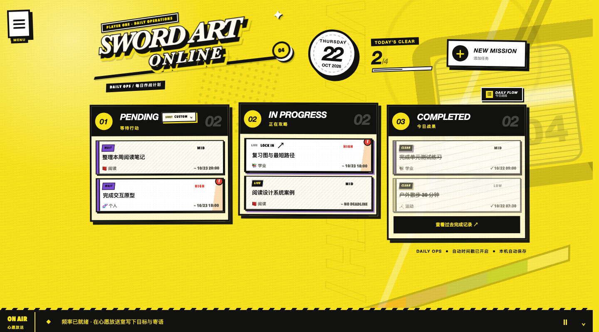

# Sword Art Online — Daily Operations

一个本地运行的个人任务与生活管理应用。用 JRPG 风格的界面组织任务、查看进度、进入专注空间；数据保存在本机 SQLite 中。

[English README](../README.md) · [架构说明](ARCHITECTURE.md) · [开发与排错](DEVELOPMENT.md)



## 功能

- **Daily Ops**：三栏任务看板，支持拖拽、排序、优先级、截止时间与循环任务。
- **Life Command**：进度总览、任务分类与日历下钻。
- **归档与日程**：搜索、筛选、查看已完成任务和每日安排。
- **Lockin Channel**：关联任务的专注空间、手动休息、分心记录和历史查询。
- **Signal Room**：目标、寄语，以及已完成目标的奖杯展厅。
- **Night Log**：按本地起床日期记录睡眠区间。
- **个性化**：日夜主题、自定义任务类别、地点与默认设置。

界面以中文为主，配合英文战术标签。预览使用隔离数据库中的虚构数据。

## 本地启动

需要 Node.js **22.13 或更新版本**与 npm。

```sh
git clone https://github.com/2DimensionalM/sword-art-online-daily-operations.git
cd sword-art-online-daily-operations
npm ci
npm run dev
```

打开 [localhost:1998](http://localhost:1998)。启动器会同时运行网页和本地数据库 API，按 `Ctrl+C` 结束两者。首次运行自动创建数据库，无需账号、API Key 或外部数据库。

`npm run check` 执行设计规则检查、ESLint、TypeScript 检查、测试与生产构建。`npm test` 使用临时数据库，不接触个人数据。

## 数据与运行边界

SQLite 文件 `data/sword-art-online.sqlite` 是唯一数据源。数据库、备份、恢复导出和私人视觉参考图均被 Git 忽略。浏览器 `localStorage` 只用于受保护的一次性旧数据迁移，`sessionStorage` 用于临时界面状态。

修改数据库前运行 `npm run db:backup`。更新代码时保留 `data/`、`backups/` 和 `recovery/`。

项目面向一台可信电脑上的个人使用，尚无云同步和多用户认证。本地 API 仅监听回环地址，不适合直接公开部署。Vinext 仍为 beta 依赖。更多技术细节见 [数据契约](DATA_ARCHITECTURE.md) 与 [视觉规范](STYLE_GUIDE.md)。

## 许可

原创项目代码采用 [MIT License](../LICENSE)。这是独立的爱好者作品，与 Sword Art Online、Persona 的创作者或权利方无隶属关系。第三方名称、标识与参考作品的权利归原权利方所有；内部参考图不随仓库分发。
